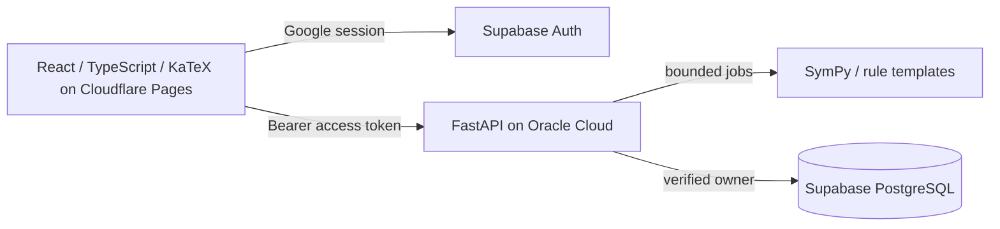

# Architecture and MVP analysis

Source: [original MVP](../PRACTICELOOP_MVP.md), copied byte-for-byte on 2026-10-15.
SHA-256: `F8605364CE622BEC262AE61AA6C3D1971AD99CF67BE97200FE00E691A4701944`.

PracticeLoop validates demand for reliable, useful, varied mathematical practice.
Google login -> choose one of five Integration topics and difficulty 1–5 ->
generate and immediately persist -> submit repeated attempts -> return Correct,
Incorrect or Invalid expression -> explicitly reveal answer/steps -> reopen
history. Profile shows account, generated count, attempted-problem count and
correct-answer count. Counting semantics for repeated attempts remain open.

Frontend routes to implement: `/`, `/login`, `/dashboard`, `/practice`, `/history`,
`/profile`. Frontend displays public data and authorized reveal responses only.
FastAPI owns generation, safe expression parsing, symbolic verification, solution
templates and persistence. Do not parse untrusted strings with eval-based SymPy
helpers. Each rule template has valid parameter/domain constraints, a generator
version, derivative checks and checked step templates. No LLM generation.

Public schema is profiles, topics, problems, attempts per specification. Private
solution table keeps answers/steps/parameters inaccessible to browser roles.
Nullable is_correct represents invalid attempts; proposal needs review.
All browser writes are denied, avoiding forged correctness and reveal flags.
Service-role DB access requires separate API-level ownership enforcement.

Production acceptance: all five topics x five levels produce valid varied problems;
supported input examples parse safely; mathematical equivalence respects domain
and integration constants; every generation and attempt persists; reveal flags and
history survive reload; Google/session/logout work; cross-user access is denied;
profile counts are correct; UI handles failures; resource limits and hosting are
verified. Per-task acceptance criteria live in the GitHub Issues.

Out of scope: tutor, chat, subscriptions, ranks, social, teachers, mobile app,
adaptive learning, achievements, OCR, other school subjects and advanced analytics.

Current code is a development skeleton: `/health`, a private polynomial fixture,
and frontend mounting/rendering tests. None of the full authenticated flow exists.
