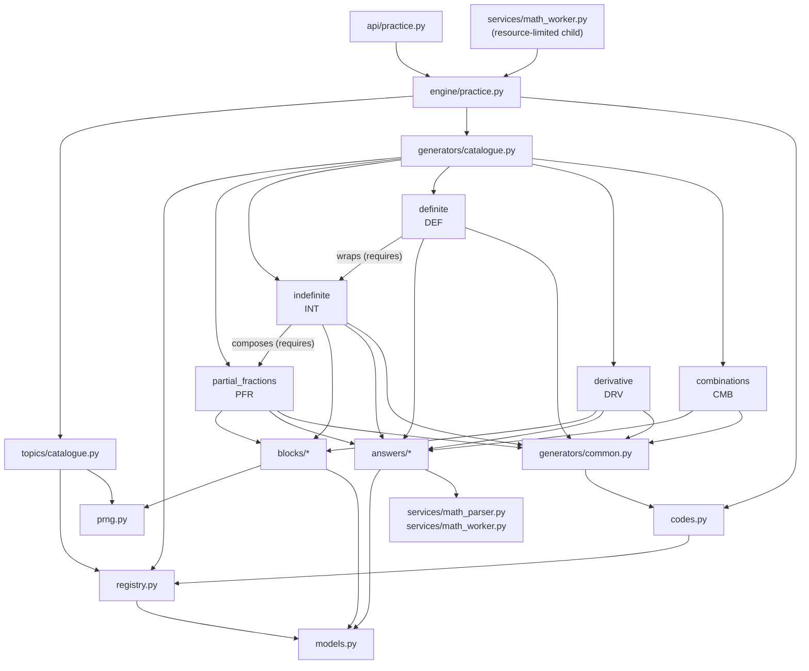

# ADR-008: composable generator engine

Date: 2026-11-01. Status: **draft** for the GrillMe review (#172); accountable
human Vlad (whatvlad). Issue #171, part of #162. It becomes accepted, amended or
replaced when Vlad accepts the #172 findings; a final ADR-008 closes the main
refactor goal.

Vlad decided on 2026-10-30 to rebuild problem generators and answer checks on a
composable engine (`docs/decisions/DECISIONS.md`, plan in
`docs/architecture/generator-refactor-mvp.md`). This ADR describes the engine as
merged in #163-#170 (PRs up to #186, main at `4b111db`), not as planned. Where
the code and the plan differ, the code is described and the difference is listed
under known limitations or open decisions.

## Context

The legacy generators in `backend/app/generators/` are topic-specific templates
whose answers are checked by one function in `app/services/answer_check.py`.
Each new task type touched shared code, and a saved problem could only be
replayed from its stored generator data. The engine lives next to the legacy
code in `backend/app/engine/` and does not change it: a test pins the SHA-256 of
`app/generators/` (`tests/test_engine_isolation.py`).

## Architecture: four layers

| Layer | Package | Knows about | Does not know about |
|---|---|---|---|
| 1. Blocks | `engine/blocks/` | integers, PRNG, SymPy | text, topics, answers |
| 2. Answers | `engine/answers/` | parsed input (`MathNode`), SymPy helpers | generators, topics |
| 3. Generators | `engine/generators/` | blocks, answers, other generators, codes | topics, the API |
| 4. Topics | `engine/topics/` | generator versions, parameter predicates | how a task is built |

Below the layers sit the core modules shared by all of them, and above them one
adapter to the practice API:

- `engine/models.py`: `Task`, `Step`, `Parameters`, `Outcome` and the
  `TaskGenerator` and `Answer` protocols.
- `engine/prng.py`: `DeterministicRNG` and `draw_valid`.
- `engine/codes.py`: `ProblemCode`, `format_code`, `parse_code`.
- `engine/registry.py`: `Registry` of generator versions and code prefixes,
  with dependency validation.
- `engine/practice.py`: issue, replay and check for the public topics served by
  the engine (#169).

### Package structure

```text
backend/app/engine/
  models.py            Task, Step, Parameters, Answer, TaskGenerator, Outcome
  prng.py              DeterministicRNG (SHA-256 stream), draw_valid (64-draw cap)
  codes.py             <PREFIX>-<VERSION>-<16-digit seed>-<2-digit check>
  registry.py          versions, prefixes, families, dependency graph
  practice.py          adapter: issue / replay / check for the practice API
  blocks/
    integers.py        IntegerRange (-12..12 with exclusions)
    polynomial.py      Polynomial (degree 0-5, from coefficients or roots)
    rational.py        PartialFractionRational (1-4 simple real poles)
  answers/
    number.py          NumberAnswer: exact rationals, no SymPy
    expression.py      ExpressionAnswer: SymPy equivalence on a domain
    antiderivative.py  AntiderivativeAnswer: up to a constant, + C required
    derivative.py      DerivativeAnswer: equal on every domain component
    _symbolic.py       shared sampling, domain and trust helpers
  generators/
    common.py          Seed parameters, code() helper
    partial_fractions.py, indefinite.py, definite.py, derivative.py,
    combinations.py    the five v1 generators
    catalogue.py       registry(): versions and permanent code prefixes
  topics/
    catalogue.py       Topic, Choice, topics(): five topic views
```

### Dependency diagram

Arrows point from a module to what it imports. Generator-to-generator arrows are
also declared in `requires` and checked by `Registry.validate_dependencies`.



The engine never imports `app/generators/` or `app/services/answer_check.py`.
It does import two legacy services: `math_parser` for the `MathNode` input tree
and `math_worker._build_sympy` to turn that tree into SymPy.

## Generator lifecycle: draw, verify, build, check

A `TaskGenerator` has `version`, `params` (a `Parameters` subclass), `answer`
(an `Answer` class), `requires` (the generator versions it uses) and two
methods. A task goes through four stages.

1. **Draw.** `draw(seed) -> Parameters`. Every v1 generator returns
   `Seed(seed=seed)`; the seed is the only parameter, validated as
   `0 <= seed < 10**16` by a strict, frozen Pydantic model.
2. **Build.** `build(params) -> Task`. The generator creates its own
   `DeterministicRNG(seed)`, draws its values in a fixed order (directly or
   through blocks), and returns a `Task`: statement (text with `\( \)` math),
   structured `Step`s (`text_key` plus LaTeX), a typed `Answer`, metadata, the
   problem code and the generator version. A composing generator builds the
   other generator's task from the same seed and reuses its steps or metadata:
   `indefinite-v1` uses `partial-fractions-v1`'s decomposition, and
   `definite-v1` wraps `indefinite-v1` and adds the bounds.
3. **Verify.** Inside `build`, before returning, the generator checks its own
   result and raises `ValueError` if it is wrong: the decomposition recombines
   (`cancel`), the antiderivative differentiates back (`is_primitive`), the
   bounds stay inside the domain and the definite value is rational. The topic
   layer redraws with `draw_valid` (at most 64 candidates) only against its
   parameter predicates. The seed sweep in `tests/test_engine_golden.py` runs
   every topic level for 1,000 seeds, so a predicate that hits the cap or a
   build that rejects its own seed fails CI.
4. **Check.** `Task.answer.check(tree) -> Outcome`, where `Outcome` is
   `correct`, `incorrect`, `missing_constant`, `invalid` or `inconclusive`. Each
   answer kind owns its rule, with no `isinstance` chain: `NumberAnswer`
   compares exact fractions without SymPy and returns `inconclusive` for
   anything outside its bounded rational subset; the three symbolic kinds apply
   ADR-003 and ADR-005 through the helpers in `_symbolic.py`.

A topic view runs stages 1-3 for a learner: `Topic.generate(level, seed,
registry)` picks a `Choice` of that level with the PRNG, draws candidate seeds
until the choice's predicate holds, and builds the task, or the wrapper's task
for the same seed when the choice names one. The returned task carries the
generator's own seed in its code, not the topic seed.

### Through the practice API

Only the public `combinations` topic is served by the engine (#169).
`api/practice.py` calls `engine.issue(topic, level)`, which takes a seed from
`secrets`, generates the task and stores a private record with exactly
`generator_version` and `code`, plus the statement, answer LaTeX and steps as
for legacy problems. To check an answer, the resource-limited math worker
recognises the record by its `code` key, rebuilds the task from the code
(`engine.replay`: parse the code, find the generator, build, and require the
same code back) and calls `answer.check`. An unusable record is `bad_record`.
Nothing private reaches the browser before a reveal.

## Problem codes and the PRNG

**PRNG (v1, frozen).** `DeterministicRNG(seed)` outputs SHA-256 of
`b"PracticeLoop PRNG v1\0"`, the seed as eight big-endian bytes and a counter
as eight big-endian bytes, one counter value per hash. `randbelow(n)` rejects
values above the largest multiple of `n` below 2**256, so it is unbiased, and
fails after 128 rejections. There is no global `random` in the engine. Changing
this output would change every shipped problem, so a new stream needs a new
domain tag and new generator versions.

**Codes.** `<PREFIX>-<VERSION>-<SEED>-<CHECK>`, for example
`CMB-1-0000000000000000-16` (calculate C(8, 7)):

- `PREFIX`: 2-8 uppercase letters naming a generator family (`PFR`, `INT`,
  `DEF`, `DRV`, `CMB`). The registry binds a prefix to one family and a family
  to one prefix; a shipped prefix is never reused.
- `VERSION`: 1-9999, bound by `register_code` to exactly one generator version
  (`CMB-1` is `combinations-v1`).
- `SEED`: 16 decimal digits.
- `CHECK`: two digits, `(salt + sum(i * digit_i)) mod 97` over the version and
  seed digits, with a salt from the prefix's SHA-256. It catches any one-digit
  change and any swap of two different digits.

`parse_code` accepts lower case, spaces and dashes in any place, and rejects an
unknown prefix or version and a wrong check. A code alone rebuilds its task,
and `tests/fixtures/engine_golden_v1.json` pins three codes per generator
version to their statement, steps, answer and metadata, so a Python, SymPy or
engine change that alters a shipped problem fails CI.

## Extension example: add a task type

This walkthrough was followed on 2026-11-01 against main `4b111db` with a
trial `permutations-v1` generator (not merged): after these steps the engine
tests, ruff and mypy passed. It is modelled on
`backend/app/engine/generators/combinations.py`.

1. **Write the generator in one new file**,
   `backend/app/engine/generators/permutations.py`:

   ```python
   """Ordered selections using integer arithmetic."""

   from math import perm

   from app.engine.answers.number import NumberAnswer
   from app.engine.generators.common import Seed, code
   from app.engine.models import Step, Task
   from app.engine.prng import DeterministicRNG


   class Permutations:
       version = "permutations-v1"
       params = Seed
       answer = NumberAnswer
       requires: tuple[str, ...] = ()

       def draw(self, seed: int) -> Seed:
           return Seed(seed=seed)

       def build(self, params: Seed) -> Task:
           rng = DeterministicRNG(params.seed)
           n = 2 + rng.randbelow(9)
           k = 1 + rng.randbelow(n)
           value = perm(n, k)
           return Task(
               statement=rf"Calculate \(P({n}, {k})\).",
               steps=(Step("permutations", rf"P({n}, {k}) = \frac{{{n}!}}{{{n - k}!}} = {value}"),),
               answer=NumberAnswer(value),
               metadata={"n": n, "k": k},
               code=code(self, "PRM", "permutations", params.seed),
               generator_version=self.version,
           )
   ```

   Use an existing `Answer` type and blocks. A generator that uses another one
   lists its version in `requires` and builds it from the same seed, as
   `indefinite.py` does. Verify the result inside `build` and raise
   `ValueError` when it is wrong.

2. **Register it** in `backend/app/engine/generators/catalogue.py`: import the
   class (keep the imports sorted) and add one tuple with a new, never-used
   prefix and family, `(Permutations(), "PRM", "permutations")`. The prefix
   must match the one passed to `code()` in step 1.
3. **Add a topic entry** in `backend/app/engine/topics/catalogue.py`:
   `Topic("permutations", "combinatorics", {1: (Choice("permutations-v1"),)}, 1)`,
   or add a `Choice` to an existing topic's level, with a predicate if only
   some parameters belong there.
4. **Pin golden problems.** Add `"permutations-v1"` to
   `backend/tests/fixtures/engine_golden_v1.json` with at least three entries,
   produced by `snapshot(generator.build(generator.draw(seed)))` from
   `tests/test_engine_golden.py`. Existing entries are never rewritten.
5. **Update the pinned topic list** in
   `backend/tests/test_engine_topics.py` (the expected topic set and answer kind
   for the new topic).
6. **Run** `..\.venv\Scripts\python.exe -m pytest tests/test_engine*.py`, ruff
   and mypy from `backend/`. The golden, dependency-graph and 1,000-seed sweep
   tests cover the new generator without further test code.

No engine module, `answer_check.py` or other generator changes. The test edits
in steps 4-5 are data, not test logic. Serving the topic to learners is a
separate step, listed under known limitations.

## Known limitations

1. **Serving a topic touches many files.** #169 changed `api/practice.py`
   (`TOPICS`), `engine/practice.py` (`ENGINE_TOPICS`, learner text in
   `STEP_TEXT`), `visuals/spec.py` (`NO_VISUAL`), a Supabase migration for the
   `topics` row, and the frontend topic list, types and mock bank, plus the
   end-to-end script. The engine side is one file; the product side is not.
2. **Prefix and code version are written twice.** Each generator passes its
   prefix, family and version `1` to `code()`, and `generators/catalogue.py`
   registers them again. `code()` builds a throwaway one-generator registry on
   every build. A mismatch is caught by the golden tests, not by construction.
3. **`draw` does nothing yet.** Every v1 generator's parameters are `Seed`, and
   all values are drawn in `build`. The typed, validated parameters the
   protocol promises are not used, so topic predicates cannot filter on real
   parameters.
4. **Topic predicates mirror generator internals.** `_rational` and
   `_polynomial` in `topics/catalogue.py` re-run the first PRNG draw of
   `derivative-v1` and `indefinite-v1` to guess the family. A change of draw
   order in those generators would silently move tasks between levels; only
   their tests protect the link.
5. **Build-time rejections are not redrawn.** If `build` raises for a seed, the
   topic does not try another one. The 1,000-seed sweep is the evidence that
   this does not happen, while the API draws from 10**16 seeds.
6. **Issuing runs in the API process.** `engine.issue` builds the task outside
   the resource-limited worker. That is harmless for integer combinations, but
   a symbolic generator (indefinite, definite, derivative) served this way
   would run SymPy without limits. Only checks run in the worker.
7. **Composition rebuilds from the same seed.** `indefinite-v1` and
   `definite-v1` build their inner task from their own seed and read it through
   `isinstance` checks and `metadata["pole"]`. Inner and outer generators share
   one PRNG stream by convention, not by an interface.
8. **Areas disagree.** The engine topic `combinations` has area
   `combinatorics`; the public topic is in `algebra`.
9. **Version strings overlap with legacy ones.** Legacy saved records also use
   `definite-v1`; only the presence of a `code` key routes a record to the
   engine.
10. **The registry has no public listing.** The golden test reads the private
    `Registry._generators` to compare shipped versions.
11. **Answers depend on legacy services.** The symbolic answers import
    `math_worker._build_sympy` (a private function) and the legacy parser.
12. **Scope of the slice.** Polynomials of degree 1-4, rational functions with
    two symmetric simple poles at ±2…±6 and equal numerators (their definite
    integral on [-1, 1] is always 0), one level for partial fractions and
    combinations, no matrices, vectors, intervals, sets or distributions. The
    engine topic is outside mixed practice and worksheets, and no `/p/<code>`
    page exists.
13. **Worker test needs Linux.** `test_the_worker_checks_a_new_engine_record`
    fails on Windows because the worker requires Linux resource limits; CI runs
    it on Linux.

## Open decisions for the GrillMe review (#172)

1. **Real parameters in `draw`.** Should `draw(seed)` return the drawn values
   (`n`, `k`, poles, coefficients) as typed `Parameters`, with `build` pure over
   them? That would let topic filters use parameters (limitation 4), but the
   code would still store only the seed, so the draw order stays frozen per
   version.
2. **One source for prefixes.** Declare `prefix`, `family` and code version on
   the generator class and let the registry and `code()` read them, so step 2
   of the extension example becomes optional or disappears (limitation 2).
3. **Composition interface.** Keep "build the inner task from the same seed"
   or pass the inner task, or its parameters, explicitly, and replace the
   `isinstance` and metadata lookups with typed outputs (limitation 7).
4. **Redraw on rejection.** Should the topic layer redraw when `build` raises,
   within the 64-draw cap, or must every seed of a shipped version build
   (limitation 5)? The deploy-time catalogue of verified seeds in the main goal
   is one answer.
5. **Where issuing runs.** Issue symbolic topics in the worker, or only from a
   prebuilt catalogue so issuing runs no SymPy (limitation 6).
6. **Topic registration for the product.** One declarative entry that drives
   the API topic list, step text, visuals and the frontend, instead of the
   seven places in limitation 1; and whether engine areas follow the public
   areas (limitation 8).
7. **Version naming.** Prefix engine version strings (for example
   `engine/definite-v1`) or keep routing by the `code` key (limitation 9).
8. **Step text.** Learner text for `Step.text_key` lives in
   `engine/practice.py`. Decide where it lives and how it is translated.
9. **Answer kinds for the next areas.** Matrix, vector, interval, set and
   boolean answers, and the `Distribution` and `IntegerDetMatrix` blocks, are
   planned but not designed.
10. **Interface stability.** Which of `TaskGenerator`, `Answer`, `Task` and
    `Topic` are frozen for the migration of the remaining topics.

## Consequences

- New task types are written only against these interfaces; the legacy
  generators stay unchanged until the main goal removes them.
- A saved engine problem is its code. The PRNG v1 output, the code format and
  every shipped generator version's output are frozen; a change means a new
  version and new golden entries.
- No further topic migration starts before #172 is accepted.
