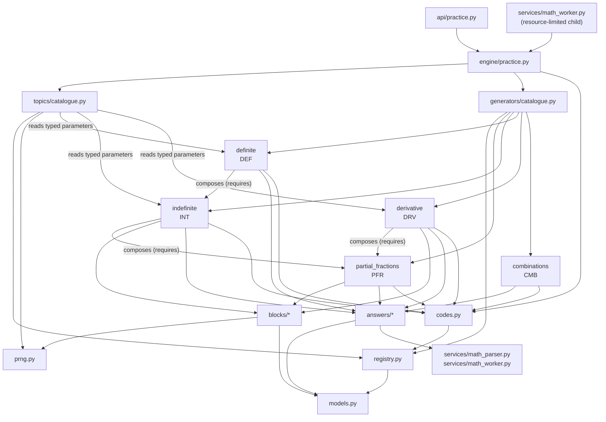

# ADR-008: composable generator engine

Date: 2026-11-01. Status: **accepted with amendments** by Vlad (whatvlad) in the
GrillMe review (#172, `docs/architecture/generator-engine-review.md`). Issue
#171, part of #162. The review's decisions amend the open decisions below. #189
reworked the core accordingly; this ADR describes the engine after #189, and
the section "Frozen interfaces" lists what may no longer change without an
amendment. A final ADR-008 (#199) closes the main refactor goal.

Vlad decided on 2026-10-30 to rebuild problem generators and answer checks on a
composable engine (`docs/decisions/DECISIONS.md`, plan in
`docs/architecture/generator-refactor-mvp.md`). This ADR describes the engine as
merged in #163-#170 (PRs up to #186) and reworked in #189, not as planned. Where
the code and the plan differ, the code is described and the difference is listed
under known limitations.

## Context

The legacy generators in `backend/app/generators/` are topic-specific templates
whose answers are checked by one function in `app/services/answer_check.py`.
Each new task type touched shared code, and a saved problem could only be
replayed from its stored generator data. The engine lives next to the legacy
code in `backend/app/engine/` and did not change it during the MVP. The #170
test that pinned the SHA-256 of `app/generators/` was removed by the #172
review, since migrations now replace legacy modules.

## Architecture: four layers

| Layer | Package | Knows about | Does not know about |
|---|---|---|---|
| 1. Blocks | `engine/blocks/` | integers, PRNG, SymPy | text, topics, answers |
| 2. Answers | `engine/answers/` | parsed input (`MathNode`), SymPy helpers | generators, topics |
| 3. Generators | `engine/generators/` | blocks, answers, other generators, codes | topics, the API |
| 4. Topics | `engine/topics/` | generator versions, parameter predicates | how a task is built |

Below the layers sit the core modules shared by all of them, and above them one
adapter to the practice API:

- `engine/models.py`: `Task`, `Step`, `Parameters`, `Drawn`, `Outcome` and the
  `TaskGenerator` and `Answer` protocols.
- `engine/prng.py`: `DeterministicRNG` and `draw_valid`.
- `engine/codes.py`: `ProblemCode`, `encode`, `format_code`, `parse_code`.
- `engine/registry.py`: `Registry` of generator versions and the code prefixes
  they declare, with dependency validation and a `versions()` listing.
- `engine/practice.py`: issue, replay and check for the public topics served by
  the engine (#169).

### Package structure

```text
backend/app/engine/
  models.py            Task, Step, Parameters, Drawn, Answer, TaskGenerator, Outcome
  prng.py              DeterministicRNG (SHA-256 stream), draw_valid (64-draw cap)
  codes.py             <PREFIX>-<VERSION>-<16-digit seed>-<2-digit check>
  registry.py          versions, prefixes, families, dependency graph, versions()
  practice.py          adapter: issue / replay / check for the practice API
  blocks/
    integers.py        IntegerRange (-12..12 with exclusions)
    polynomial.py      Polynomial (degree 0-5, from coefficients or roots)
    rational.py        PartialFractionRational (1-4 simple real poles)
  answers/
    number.py          NumberAnswer: exact rationals, no SymPy
    expression.py      ExpressionAnswer: SymPy equivalence on a domain
    antiderivative.py  AntiderivativeAnswer: up to a constant, + C required
    derivative.py      DerivativeAnswer: equal on every domain component
    _symbolic.py       shared sampling, domain and trust helpers
  generators/
    partial_fractions.py, indefinite.py, definite.py, derivative.py,
    combinations.py    the five v1 generators, each with its parameters,
                       prefix, family, code version and step text
    catalogue.py       registry(): the list of shipped generators
  topics/
    catalogue.py       Topic, Choice, topics(): five topic views, AREAS
```

### Dependency diagram

Arrows point from a module to what it imports. Generator-to-generator arrows are
also declared in `requires` and checked by `Registry.validate_dependencies`.



The engine never imports `app/generators/` or `app/services/answer_check.py`.
It does import two legacy services: `math_parser` for the `MathNode` input tree
and `math_worker._build_sympy` to turn that tree into SymPy.

## Generator lifecycle: draw, build and verify, check

A `TaskGenerator` declares, as class attributes:

- `version`: the generator version string (`combinations-v1`);
- `prefix`, `family`, `code_version`: its permanent code prefix, family name
  and numeric code version (`CMB`, `combinations`, `1`), written once in the
  generator's file. `Registry.register` reads them and binds the code, and
  `build` writes the task's code from them with `codes.encode`;
- `params`: a `Drawn` subclass (strict, frozen Pydantic, with `seed` in
  `0 <= seed < 10**16`);
- `answer`: its `Answer` class;
- `requires`: the generator versions it composes;
- `step_text`: every step key it can emit, with its English learner text.

A task goes through three stages.

1. **Draw.** `draw(seed) -> Drawn`. All PRNG calls happen here: the generator
   creates `DeterministicRNG(seed)` and returns the drawn values as typed
   parameters (`CombinationParams(seed, n, k)`, `PartialFractionParams(seed,
   pole, numerator)`). A composing generator's parameters hold the inner
   generator's parameters, drawn by calling `inner.draw(seed)`:
   `IndefiniteParams.function` is either `PartialFractionParams` or a
   `Polynomial` block, `DerivativeParams` likewise, and
   `DefiniteParams.integral` is an `IndefiniteParams`. #189 kept the v1 PRNG
   call order exactly, so every shipped code still rebuilds the same task.
2. **Build and verify.** `build(params) -> Task` is pure over the parameters.
   It returns a `Task`: statement (text with `\( \)` math), structured `Step`s
   (`text_key` plus LaTeX), a typed `Answer`, metadata (display and test data,
   which no other generator reads), the problem code and the generator version.
   A generator that others compose also exposes a typed result for them:
   `PartialFractions.decompose(params) -> Decomposition` (combined fraction,
   decomposition, domain, steps) and `IndefiniteIntegral.integrate(params) ->
   Integral` (integrand, primitive, domain, steps). Outer generators call these
   with the inner parameters they hold; no generator reads another generator's
   `Task` through `isinstance` or `metadata`. Before returning, the generator
   checks its own result and raises `ValueError` if it is wrong: the
   decomposition recombines (`cancel`), the antiderivative differentiates back
   (`is_primitive`), the bounds stay inside the domain and the definite value
   is rational.
3. **Check.** `Task.answer.check(tree) -> Outcome`, where `Outcome` is
   `correct`, `incorrect`, `missing_constant`, `invalid` or `inconclusive`. Each
   answer kind owns its rule, with no `isinstance` chain: `NumberAnswer`
   compares exact fractions without SymPy and returns `inconclusive` for
   anything outside its bounded rational subset; the three symbolic kinds apply
   ADR-003 and ADR-005 through the helpers in `_symbolic.py`.

At catalogue build time, a topic view runs stages 1-2: `Topic.generate(level, seed,
registry)` picks a `Choice` of that level with the PRNG, then draws candidate
seeds, at most 64 (`MAX_DRAWS`). A candidate is skipped when the choice's
predicate rejects its typed parameters (`_rational` reads
`IndefiniteParams.rational`, through `DefiniteParams.integral` for definite
integrals), or when `build` raises `ValueError`; the latter is logged as a
warning. Every seed of a shipped version is still expected to build: the seed
sweep in `tests/test_engine_golden.py` runs every topic level for 1,000 seeds
and fails on such a warning or on the cap. The returned task carries the
generator's own seed in its code, not the topic seed. Topic areas are the
public areas (`AREAS`: `algebra`, `mathematical-analysis`).

### Through the practice API

A topic entry is also the product side of a topic (#191, an amendment of the
frozen `Topic`): besides slug, area, levels and mixed-practice weight it holds
the learner-facing `title`, the worksheet `space_cm`, the solution `visual`
(`None` for none) and `served`. `engine.ENGINE_TOPICS` is derived from the
entries with `served=True`; `api/practice.py` lists each of them in `TOPICS`
(replacing an old-engine topic of the same slug in place), `GET /topics`
returns that list, and the frontend reads it from there. `visuals/spec.py` takes
an engine record's visual from its topic entry. Only `combinations` is served
(#169); it is in Algebra mixed practice with weight 1 and in worksheets
through the deploy-time catalogue (#192). Symbolic topic migrations remain
in #193-#197.

`api/practice.py` calls `engine.issue(topic, level)`, which randomly picks
already-rendered private data from that cell's pool. It stores exactly
`generator_version` and `code` as the generator record, plus the statement,
answer LaTeX and steps as for legacy problems. Worksheet picking uses the same
pools, without rebuilding selected tasks. Checking remains in the
resource-limited math worker: it recognises the `code` key, rebuilds the task
from its versioned code (`engine.replay`) and calls `answer.check`. An unusable
record is `bad_record`. Nothing private reaches the browser before a reveal.

### Amendment: verified release catalogue (#192)

Every engine topic x level, including entries not yet served, has **64 unique
codes** in `backend/.engine-catalogue.json`. This is a private, ignored JSON
artifact alongside the backend in each release, not a frontend asset, database
migration or runtime service. Format version 1 holds the pool size and cells;
each code stores its generator version, rendered statement, answer LaTeX and
steps with English learner text. The pool deduplicates codes, not equivalent
mathematical exercises: different seeds may render the same exercise.

`python -m app.engine.catalogue` builds all cells deterministically, trying
topic seeds 0..255 in each cell until it has 64 codes. Each topic call retains
its existing 64-candidate cap. Generators verify their mathematics in `build`;
rejected candidates are logged, duplicates skipped, and any unfillable cell or
invalid rendering fails the complete build. Tests replay **every pooled code**
and compare all stored fields, including steps. Existing PRNG, code format,
shipped generator versions and golden fixtures are unchanged.

The writer replaces the artifact atomically only after a complete build and
structural validation. Oracle `release.sh` builds it after installing pinned
dependencies and **before** changing `current` or restarting the API: failure
leaves the old release live. Each retained release keeps its own artifact for
rollback. API startup validates the format, exact topic/level coverage, sizes,
unique codes, check digits and generator versions, then caches immutable data.
This validation and picking perform no SymPy calls. There is no request-time
build or fallback for missing pools, including for integer combinations.

The size 64 covers a maximum 40-problem worksheet from one cell with room to
spare. Worksheet capacity is the pool length, and repeated groups and mixed
groups share the picker so no code repeats on one worksheet. Generated engine
worksheets store the pool's statement, answer and steps directly; PDF reads
those saved fields. Saved problems and worker replay do not depend on a code
remaining in the current release's pool. Public symbolic topic migrations and
their Supabase rows belong to #193-#197; building an unserved pool does not
expose its topic to learners.

## Problem codes and the PRNG

**PRNG (v1, frozen).** `DeterministicRNG(seed)` outputs SHA-256 of
`b"PracticeLoop PRNG v1\0"`, the seed as eight big-endian bytes and a counter
as eight big-endian bytes, one counter value per hash. `randbelow(n)` rejects
values above the largest multiple of `n` below 2**256, so it is unbiased, and
fails after 128 rejections. There is no global `random` in the engine. Changing
this output would change every shipped problem, so a new stream needs a new
domain tag and new generator versions.

**Codes.** `<PREFIX>-<VERSION>-<SEED>-<CHECK>`, for example
`CMB-1-0000000000000000-16` (calculate C(8, 7)):

- `PREFIX`: 2-8 uppercase letters naming a generator family (`PFR`, `INT`,
  `DEF`, `DRV`, `CMB`). The registry binds a prefix to one family and a family
  to one prefix; a shipped prefix is never reused.
- `VERSION`: 1-9999, the generator's `code_version`, bound by the registry to
  exactly one generator version (`CMB-1` is `combinations-v1`).
- `SEED`: 16 decimal digits.
- `CHECK`: two digits, `(salt + sum(i * digit_i)) mod 97` over the version and
  seed digits, with a salt from the prefix's SHA-256. It catches any one-digit
  change and any swap of two different digits.

`parse_code` accepts lower case, spaces and dashes in any place, and rejects an
unknown prefix or version and a wrong check. A code alone rebuilds its task,
and `tests/fixtures/engine_golden_v1.json` pins three codes per generator
version to their statement, steps, answer and metadata, so a Python, SymPy or
engine change that alters a shipped problem fails CI.

## Extension example: add a task type

This walkthrough was first followed on 2026-11-01 against main `4b111db` with a
trial `permutations-v1` generator (not merged) and updated for the #189
interfaces. It is modelled on `backend/app/engine/generators/combinations.py`.

1. **Write the generator in one new file**,
   `backend/app/engine/generators/permutations.py`:

   ```python
   """Ordered selections using integer arithmetic."""

   from math import perm

   from pydantic import Field

   from app.engine.answers.number import NumberAnswer
   from app.engine.codes import encode
   from app.engine.models import Drawn, Step, Task
   from app.engine.prng import DeterministicRNG


   class PermutationParams(Drawn):
       n: int = Field(ge=2, le=10)
       k: int = Field(ge=1, le=10)


   class Permutations:
       version = "permutations-v1"
       prefix = "PRM"
       family = "permutations"
       code_version = 1
       params = PermutationParams
       answer = NumberAnswer
       requires: tuple[str, ...] = ()
       step_text = {"permutations": "Count the ordered selections."}

       def draw(self, seed: int) -> PermutationParams:
           rng = DeterministicRNG(seed)
           n = 2 + rng.randbelow(9)
           return PermutationParams(seed=seed, n=n, k=1 + rng.randbelow(n))

       def build(self, params: PermutationParams) -> Task:
           n, k = params.n, params.k
           value = perm(n, k)
           return Task(
               statement=rf"Calculate \(P({n}, {k})\).",
               steps=(Step("permutations", rf"P({n}, {k}) = \frac{{{n}!}}{{{n - k}!}} = {value}"),),
               answer=NumberAnswer(value),
               metadata={"n": n, "k": k},
               code=encode(self.prefix, self.code_version, params.seed),
               generator_version=self.version,
           )
   ```

   Use an existing `Answer` type and blocks, and a new, never-used prefix and
   family. A generator that uses another one lists its version in `requires`,
   holds the inner parameters in its own (`inner.draw(seed)` inside `draw`),
   and calls the inner generator's typed result method, as `definite.py` does
   with `IndefiniteIntegral.integrate`; its `step_text` includes the inner
   generator's keys. Verify the result inside `build` and raise `ValueError`
   when it is wrong.

2. **Register it** in `backend/app/engine/generators/catalogue.py`: import the
   class (keep the imports sorted) and add `Permutations()` to the list.
3. **Add a topic entry** in `backend/app/engine/topics/catalogue.py`:
   `Topic("permutations", "algebra", {1: (Choice("permutations-v1"),)}, 1,
   title="Permutations", space_cm=4)`,
   or add a `Choice` to an existing topic's level, with a predicate over the
   typed parameters if only some of them belong there.
4. **Pin golden problems.** Add `"permutations-v1"` to
   `backend/tests/fixtures/engine_golden_v1.json` with at least three entries,
   produced by `snapshot(generator.build(generator.draw(seed)))` from
   `tests/test_engine_golden.py`. Existing entries are never rewritten.
5. **Update the pinned topic list** in
   `backend/tests/test_engine_topics.py` (the expected topic set and answer kind
   for the new topic).
6. **Run** `..\.venv\Scripts\python.exe -m pytest tests/test_engine*.py`, ruff
   and mypy from `backend/`. The golden, dependency-graph, step-text and
   1,000-seed sweep tests cover the new generator without further test code.

No engine module, `answer_check.py` or other generator changes. The test edits
in steps 4-5 are data, not test logic. Serving the topic to learners (#191) is
`served=True` on its entry plus an additive Supabase migration for its `topics`
row, because saved records reference that row; the API topic list, mixed
practice, visual decision and frontend follow from the entry.

## Known limitations

The list is the draft's, kept with its numbers. Items 2-5, 7, 8 and 10 were
resolved by #189, item 1 by #191 and item 6 by #192 as described above;
the rest are tracked in the review.

1. *Resolved in #191: one declarative topic entry; the frontend reads topics
   from the API.* **Serving a topic touched many files.** #169 changed `api/practice.py`
   (`TOPICS`), `engine/practice.py` (`ENGINE_TOPICS`; learner text moved to the
   generators in #189), `visuals/spec.py` (`NO_VISUAL`), a Supabase migration for the
   `topics` row, and the frontend topic list, types and mock bank, plus the
   end-to-end script. The engine side is one file; the product side is not.
2. *Resolved in #189: prefix, family and code version are generator class
   attributes.* **Prefix and code version were written twice.** Each generator passes its
   prefix, family and version `1` to `code()`, and `generators/catalogue.py`
   registers them again. `code()` builds a throwaway one-generator registry on
   every build. A mismatch is caught by the golden tests, not by construction.
3. *Resolved in #189: `draw` returns typed parameters.* **`draw` did nothing.** Every v1 generator's parameters are `Seed`, and
   all values are drawn in `build`. The typed, validated parameters the
   protocol promises are not used, so topic predicates cannot filter on real
   parameters.
4. *Resolved in #189: predicates read the typed parameters.* **Topic
   predicates mirrored generator internals.** `_rational` and
   `_polynomial` in `topics/catalogue.py` re-run the first PRNG draw of
   `derivative-v1` and `indefinite-v1` to guess the family. A change of draw
   order in those generators would silently move tasks between levels; only
   their tests protect the link.
5. *Resolved in #189: the topic takes the next candidate and logs it.*
   **Build-time rejections were not redrawn.** If `build` raises for a seed, the
   topic does not try another one. The 1,000-seed sweep is the evidence that
   this does not happen, while the API draws from 10**16 seeds.
6. *Resolved in #192: issuing and worksheets pick rendered private pools.*
   **Issuing ran in the API process.** Before #192, `engine.issue` built tasks
   outside the resource-limited worker. It now only picks rendered data;
   checks still run in the worker.
7. *Resolved in #189: outer parameters hold inner parameters, and inner
   generators expose `Decomposition` and `Integral`.* **Composition rebuilt
   from the same seed.** `indefinite-v1` and
   `definite-v1` build their inner task from their own seed and read it through
   `isinstance` checks and `metadata["pole"]`. Inner and outer generators share
   one PRNG stream by convention, not by an interface.
8. *Resolved in #189: engine topics use only the public areas.* **Areas
   disagreed.** The engine topic `combinations` has area
   `combinatorics`; the public topic is in `algebra`.
9. **Version strings overlap with legacy ones.** Legacy saved records also use
   `definite-v1`; only the presence of a `code` key routes a record to the
   engine.
10. *Resolved in #189: `Registry.versions()`.* **The registry had no public
    listing.** The golden test reads the private
    `Registry._generators` to compare shipped versions.
11. **Answers depend on legacy services.** The symbolic answers import
    `math_worker._build_sympy` (a private function) and the legacy parser.
12. **Scope of the slice.** Polynomials of degree 1-4, rational functions with
    two symmetric simple poles at ±2…±6 and equal numerators (their definite
    integral on [-1, 1] is always 0), one level for partial fractions and
    combinations, no matrices, vectors, intervals, sets or distributions. `combinations`
    joins mixed practice (#191) and worksheets (#192); no `/p/<code>` page exists.
13. **Worker test needs Linux.** `test_the_worker_checks_a_new_engine_record`
    fails on Windows because the worker requires Linux resource limits; CI runs
    it on Linux.

## Open decisions for the GrillMe review (#172)

Resolved on 2026-11-01: see `docs/architecture/generator-engine-review.md` for
the decision on each item and the issue that implements it.

1. **Real parameters in `draw`.** Should `draw(seed)` return the drawn values
   (`n`, `k`, poles, coefficients) as typed `Parameters`, with `build` pure over
   them? That would let topic filters use parameters (limitation 4), but the
   code would still store only the seed, so the draw order stays frozen per
   version.
2. **One source for prefixes.** Declare `prefix`, `family` and code version on
   the generator class and let the registry and `code()` read them, so step 2
   of the extension example becomes optional or disappears (limitation 2).
3. **Composition interface.** Keep "build the inner task from the same seed"
   or pass the inner task, or its parameters, explicitly, and replace the
   `isinstance` and metadata lookups with typed outputs (limitation 7).
4. **Redraw on rejection.** Should the topic layer redraw when `build` raises,
   within the 64-draw cap, or must every seed of a shipped version build
   (limitation 5)? The deploy-time catalogue of verified seeds in the main goal
   is one answer.
5. **Where issuing runs.** Issue symbolic topics in the worker, or only from a
   prebuilt catalogue so issuing runs no SymPy (limitation 6).
6. **Topic registration for the product.** One declarative entry that drives
   the API topic list, step text, visuals and the frontend, instead of the
   seven places in limitation 1; and whether engine areas follow the public
   areas (limitation 8).
7. **Version naming.** Prefix engine version strings (for example
   `engine/definite-v1`) or keep routing by the `code` key (limitation 9).
8. **Step text.** Learner text for `Step.text_key` lives in
   `engine/practice.py`. Decide where it lives and how it is translated.
9. **Answer kinds for the next areas.** Matrix, vector, interval, set and
   boolean answers, and the `Distribution` and `IntegerDetMatrix` blocks, are
   planned but not designed.
10. **Interface stability.** Which of `TaskGenerator`, `Answer`, `Task` and
    `Topic` are frozen for the migration of the remaining topics.

## Frozen interfaces

Since #189 (decision 12 of the review) these are frozen; changing any of them
needs an amendment to this ADR:

- `Answer` (`kind`, `latex()`, `check(tree)`) and `Outcome`;
- `Task` and `Step`;
- `TaskGenerator`: `version`, `prefix`, `family`, `code_version`, `params` (a
  `Drawn` subclass), `answer`, `requires`, `step_text`, `draw(seed)` and
  `build(params)`;
- `Topic` and `Choice`: slug, public area, levels 1-5 of choices, mixed weight,
  predicates over typed parameters, at most 64 candidates per generation;
- PRNG v1 (`DeterministicRNG`) and the code format with its check digits.

Engine version strings stay as they are (`definite-v1` also exists in legacy
records); records route by the `code` key. New answer kinds, blocks and
generators are additions, not changes.

## Consequences

- New task types are written only against these interfaces; the legacy
  generators stay unchanged until the main goal removes them.
- A saved engine problem is its code. The PRNG v1 output, the code format and
  every shipped generator version's output are frozen; a change means a new
  version and new golden entries.
- Topic migrations (#193-#197) are written against the frozen interfaces.

## Amendment: integral curriculum migration (#193)

The six public integral topics now issue native engine codes at their existing
levels (basic, substitution, rational and trigonometric: 1-5; parts: 1-3;
definite integrals: 1-5). Five families each register an indefinite version
(code version 1) and a bounded version (code version 2), with prefixes BAS,
SUB, IPT, RNI and TGI. Existing v1 engine codes and golden entries are retained.

`IntegralForm` is a strict frozen mathematical block: family, allowlisted
template, nonzero small coefficient, secondary coefficient and power/scale.
All PRNG calls occur in `draw`. The native generators consume this typed block;
there are no legacy records, imports or task-metadata lookups in the engine.
The block caches pure results by drawn values, excluding the seed. It proves
the primitive and each displayed transformation exactly on every real-domain
component. A bounded form uses the approved interval inside that domain and
computes the exact finite real difference F(b)-F(a).

No new answer kind or input syntax is needed: indefinite tasks use
`AntiderivativeAnswer` with the existing constant/domain policy; bounded tasks
use `ExpressionAnswer` with no variables, permitting exact logarithms, pi and
exponentials as well as rationals. Incorrect native answers use the engine's
general feedback; missing constants retain their explicit outcome. The old
legacy mistake classifiers are not imported by engine tasks.

One compatible change to the frozen Topic contract is approved by this
amendment: `mixed_weight` may be zero to exclude an entry from mixed practice.
This preserves the definite-integrals topic's existing weight 0; other fields,
the generator/answer interfaces, PRNG and code format are unchanged. The
existing nonnegative weights and worksheet space are retained for every topic.

The release pools now cover the migrated cells; issuing excludes the learner's
latest half-pool records, and worksheets select only pre-rendered data. A
`single-integral` visual declaration routes native typed integral data to the
existing definite/indefinite plotting logic after a solution reveal. Archived
legacy problems still reopen/reveal/print solely from stored fields and refuse
new attempts with `409 problem_archived` (#190).

New versions have three golden entries each; the existing 1,000-seed topic
sweep covers all migrated cells. Exact form tests, own-answer and constant
checks, no-SymPy issuing tests, archive tests, worksheet/persistence tests and
Linux limited-worker tests cover the migration. No database migration or
frontend input change is required because topic rows and answer kinds exist.

## Amendment: multiple-integral migration (#194)

Double and triple integrals now use `practice-double-v1` (DBL-1) and
`practice-triple-v1` (TPL-1). Both retain levels 1-5, mixed weight 2 and their
existing worksheet writing space. The former records become read-only archive
entries; new records contain the engine version and code only.

No new answer kind or editor is required: each result is an exact real scalar,
so both generators use `ExpressionAnswer` with no variables. Answers may contain
rational values, pi, exponentials or logarithms and never an integration constant.
Native incorrect answers use general feedback rather than the legacy-specific
missing-Jacobian or wrong-bound classifiers.

`MultipleForm` is a strict frozen block holding dimension, allowlisted template,
variant and nonzero small coefficient. `draw` picks only these values. Typed
`Setup` objects retain innermost-first bounds, coordinate system and integrand
without the Jacobian. Exact setup integration inserts r for polar/cylindrical
coordinates. A cached proof checks the coordinate substitution against the
stated integrand and recomputes the primary exact value before a task can build;
worked steps integrate the scaled setup in the declared order. No task metadata,
serialized expression or legacy generator is used by another generator.

The curriculum tables, geometric variants and declared values are preserved;
tests compare every variant to the verified pre-migration curriculum and check
alternate integration orders where they were declared exact. The release
catalogue covers all ten public multiple-integral cells. Typed setup adapters
retain `region2d` and `solid3d` graphs on solution reveals without changing the
browser contract. The 1,000-seed sweep, new golden entries, every pooled-code
replay and Linux limited-worker tests cover each new cell. Existing versions,
code formats and frozen generator/answer interfaces are unchanged.

## Amendment: derivative migration (#195)

Single and partial derivatives now use native release pools at levels 1-5:
`practice-derivative-v1` (SDV-1) and `practice-partial-v1` (PDV-1).
Strict frozen forms retain the complete template tables, coefficients, real
domains, differentiation rules, coordinate substitutions and Jacobians.
Cached builds independently prove every derivative and displayed step; mixed
partials are also verified in the other order. No legacy generator is imported.

Existing `DerivativeAnswer` and `ExpressionAnswer` cover these answers. Native
incorrect answers use general feedback; arbitrary constants remain disallowed.
Mixed weights, worksheet space and the absence of solution visuals are retained.
Old derivative records are read-only archives; new records contain only code
and generator version. New golden entries and the 1,000-seed sweep cover all
ten migrated cells, with exact curriculum comparisons and limited-worker checks.

A generator may additionally expose private `input_variables(drawn_params)`
metadata. This optional helper does not change the frozen generator protocol.
The partial generator returns a fresh plain mapping from its allowlisted
template, including positive r/y and real theta where required. The API obtains
the exact answer grammar from the code without building a task or calling SymPy.
The limited worker reconstructs the task once and checks with that grammar.
No variable declarations or mathematical internals are added to public records.

## Amendment: Algebra migration (#196)

The current Algebra tasks need exact real scalar/expression answers: a 2x2
determinant, complex modulus, quadratic root sum (with multiplicity), or rational
partial fractions. `ExpressionAnswer` and the existing editor suffice; matrix
and complex-valued answer kinds belong to future content that needs them.

Native `AlgebraForm` holds an allowlisted kind and two integers 1-5. Independent
proofs use a matrix determinant, complex absolute value, all polynomial roots
(including nonreal/repeated roots), and exact rational decomposition. Drawn
parameters retain the existing levels 1-5 and their coefficient ranges; this
migration does not invent harder content for previously identical levels.

The four new versions are `practice-matrices-v1` (MTR-1),
`practice-complex-v1` (CPX-1), `practice-root-sum-v1` (VRS-1) and
`practice-partial-fractions-v1` (PFA-1). Partial fractions declare real x through
the private code-derived grammar helper. Each topic keeps its mixed weight and
worksheet space. Legacy symbolic records become archives; shipped PFR-1 codes
and all previous golden entries remain unchanged. New golden entries, every
coefficient pair, the 1,000-seed sweep, pool replay, archive/worksheet tests and
limited Linux workers cover all twenty migrated cells.
